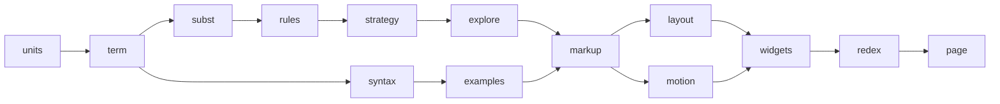

# AGENTS.md

Interactive reduction rules for the lambda calculus, headed for a post on krukah.com: a Rust
workspace with a Leptos (CSR) frontend built by Trunk. See README.md for how a page embeds the
widgets. **Subtree rules live in each crate's `AGENTS.md`**, which opens with a small diagram.

The app was ported from a JavaScript original, since deleted; `docs/plan.md` is the port plan and
`docs/port.md` its ledger.

## Subtree AGENTS.md index

| Path | Covers |
|---|---|
| `crates/units/AGENTS.md` | `Px`, `Ms`, and numbers printed as JavaScript prints them |
| `crates/term/AGENTS.md` | Term nodes, uids and provenance, paths, names, α-keys, Env, the global constant set |
| `crates/subst/AGENTS.md` | Capture-avoiding substitution, `prepare` (renaming), the naive capturing variant |
| `crates/syntax/AGENTS.md` | Tokenizer, parser, `Program` (defs and `--` notes), text printer |
| `crates/rules/AGENTS.md` | The seven rules: `Kind`, redex search, schemas, bindings, contraction, `step` |
| `crates/strategy/AGENTS.md` | Normal, applicative and WHNF order; the step-capped runner |
| `crates/explore/AGENTS.md` | The reduction graph: exploration to a cap, edges by rule, cycle detection |
| `crates/layout/AGENTS.md` | Pure geometry: graph rows, columns, edge routes; thumbnails |
| `crates/examples/AGENTS.md` | Example and race programs as data |
| `crates/markup/AGENTS.md` | The typed HTML/SVG tree, classes, attributes, selectors, and its one escaping renderer |
| `crates/motion/AGENTS.md` | Motion algebra on WAAPI: primitives, compositions, ghosts, timing |
| `crates/widgets/AGENTS.md` | Leptos widgets and the shared `Session` |
| `crates/redex/AGENTS.md` | `mount_all`, the embedding facade |
| `crates/lints/README.md` (+ `CLAUDE.md`) | House Lint: diff-scoped style rules, what gates a commit |



## Rules

- The engine crates (`units` … `examples`), `markup` and `layout` stay free of the DOM: no
  `web-sys`, no `leptos`. They are covered by `cargo test` against `fixtures/`, frozen regression
  data that changes only deliberately, with the behaviour change that needs it.
- A widget queries only inside its own root and talks to others only through the `Session`
  context. No element ids, no module-level DOM state: a host page may hold several widgets.
- Markup is a `markup::Node`, never a string: classes come from the closed `markup::Class` enum
  (`rdx-` for structure, short tokens for the term), attributes are typed, and the renderer is
  the one place that escapes. Every selector in `redex.css` starts with `.redex`: host pages run
  their own CSS (Jekyll prose, rouge's `.n`/`.c`/`.k` highlighting), so unscoped names collide.
- Colors and fonts come only from `--rdx-*` tokens, declared under `:where(:root)` so any host rule
  overrides them. No literal colors in widget rules.
- Visual direction: the Lean documentation, not an app. Black on white, Lean blue (`#0073a3`), thin
  gray rules, square corners, Source Sans 3 and Source Code Pro, keywords bold, bound variables italic.
- Strategies never perform η, as in Lean, where η only appears when comparing terms. η fires only
  when clicked.
- One firing grammar for every rule: match, bind, move (README "Core model"). A new rule needs a
  schema and `bindings` in `rules`, and every node it builds from an old one records `from`; the
  workbench then animates it with no rule-specific code.
- All motion goes through the `motion` crate: primitives (`enter`, `exit`, `slide`, `resize`, `fly`,
  `crossfade`, `draw`) composed with `all`, `seq`, `after`, `stagger`, `act`. No other crate calls
  `Element::animate` or adds a CSS keyframe for movement or opacity; CSS keyframes are for color
  afterglows only.
- Motion is direct and calm: things travel in straight lines, appear and disappear by fading in
  place, and every firing runs on one fixed timeline (`motion::Schedule`: hold, move, settle),
  the same length for every rule and term size, with no stagger.
- The workbench never changes height. Each region has a fixed size and scrolls inside it; what
  appears later (the α panel, the source editor) takes a tab in the lower pane, never new rows.
  `scripts/steady.mjs` checks it every frame.
- Keep the three color channels apart: rule ink, binder hue, highlighter.
- Domain values cross function boundaries as their types (`Name`, `Path`, `Uid`, `Px`, `Ms`,
  `Step`, `Cap`, `Depth`, `Kind`, …), never as bare strings or numbers.
- `Motion::enabled()` gates every animation (the primitives check it), the CSS honors
  `prefers-reduced-motion`, and every primitive resolves on a timer even if its animation stalls.
- Examples are self-contained: each carries the `def`s it uses.

## Check

```bash
cargo fmt --all --check
cargo clippy --workspace --all-targets -- -D warnings
cargo test --workspace
trunk build --release                                         # the page, into dist/
cargo run --manifest-path crates/lints/Cargo.toml -- --base master
cargo run --manifest-path crates/lints/Cargo.toml -- --all   # and --only each opt-in rule
trunk serve                                                   # http://localhost:8001
scripts/site.sh && npm install && node scripts/reveal.mjs     # host-page build and browser check
node scripts/steady.mjs   # the workbench's height, every frame (blog target needs Jekyll on :4011)
node scripts/tempo.mjs    # per-phase timing of each firing, from the performance marks
```

## Taste & Stylistic Tendencies

These apply to **every** Rust file in the repo.

- **Blank lines go BETWEEN blocks, NEVER inside them.** A "block" is anything with a body: `fn`, `impl`, `trait`, `struct`, `enum`, `mod`. This rule is frequently misapplied in both directions — be precise:
  - **INSIDE a function body: no blank lines.** Cuddle all statements together, even across logical sections. Do not use blank lines to separate comment-labeled sections (e.g. `// Preflop` / `// Flop` inside one test fn). If a fn feels like it needs visual sections, split it into multiple fns.
  - **BETWEEN fn definitions in an `impl` or `trait` block: one blank line required.** Any `\n    }\n    fn` (and the 8-space nested variant) is a violation — insert a blank line. `cargo fmt` does NOT enforce this. The bulk-fix incantation must cover every visibility/modifier combination — `fn`, `pub fn`, `pub(crate) fn`, `async fn`, `pub async fn`, `const fn`, `pub const fn`, `unsafe fn`, etc.: `perl -i -0pe 's/\n(    \})\n(    (?:pub(?:\([^)]+\))? )?(?:async |const |unsafe )*fn )/\n$1\n\n$2/g'` (then run it again with 8-space indent).
  - **BETWEEN trait associated types/consts and the first `fn`: one blank line required.** Pattern `\n    type X = Y;\n    fn` or `\n    const FOO: T = …;\n    fn` is a violation. The separator goes after the LAST associated item, not between successive `type`/`const` decls.
  - **BETWEEN struct/enum/impl/mod blocks at module level: one blank line** (rustfmt usually handles this).
  - Hand-curated comments or spacing between top-level blocks for visual grouping are fine — the rule targets _within-body_ violations and _missing-between-block_ violations, not module-scope aesthetics.
- Prefer flat glob imports over explicit item imports. Use `use crate::module::*;` rather than `use crate::module::{Foo, Bar, Baz};`.
- Try moderately hard to keep variable names to exactly one word. One-word naming encourages thinking carefully about semantics. Also underscores are ugly.
- Try moderately hard to keep variable names of coupled variables the same number of characters. This is for visual alignment and making function "shape" manifest.
- If you're using a library import, try to use the fully qualified name of the imported symbol, unless you end up scattering it across many lines or it gets messy.
- If you use an intermediate variable exactly once, you must inline it. Unless the compiler won't let you. Binding to single-use intermediate variables is HIGHLY discouraged.
- Similar to the previous rule, you should always opt for method chaining over serial re-assignments. The cleanest function shapes are those that are simply chained method calls in a single statement.
- Similar to the previous rule, you should always avoid explicit `for/while/loop` blocks, unless writing side effects. Use chained iterators and short closures instead. Exceptions for mutative and async for loops are okay.
- Avoid using type hints when they are not necessary. Opt for turbofish syntax when type inference fails, and only fallback to explicit type hints when necessary.
- Always use `where` syntax for trait bounds on generic types, never inline bounds. This improves readability and makes signatures easier to scan.

```rust
// ✅ Good - where syntax
impl<R, W> Worker<R, W>
where
    R: RegretSchedule,
    W: WeightSchedule,
{ ... }

// ❌ Bad - inline bounds
impl<R: RegretSchedule, W: WeightSchedule> Worker<R, W> { ... }
```

- Avoid `pub` fields on structs. Instead, expose data through shallow one-liner methods that return references (`&T`) or mutable references (`&mut T`). This preserves encapsulation and makes refactoring internals painless.

```rust
// ✅ Good - accessor methods
struct Foo {
    bar: Vec<u8>,
}
impl Foo {
    fn bar(&self) -> &[u8] { &self.bar }
    fn bar_mut(&mut self) -> &mut Vec<u8> { &mut self.bar }
}

// ❌ Bad - pub fields
struct Foo {
    pub bar: Vec<u8>,
}
```

- **One type per file.** One exposed struct, enum, union, or trait per file. A private type, a marker with no fields or variants, a type inside a function body, and an inline `mod` each crowd the file the same way. A trait and the types beside it that implement it count as one family, and the file's namesake owns the file. File order: imports, types, trait impls, core impl blocks, helper impls, tests. `crates/widgets` is exempt — a Leptos file holds the component and the types it renders.
- **No free functions.** Hang every function on a type: a method when it has a receiver, an associated function when it constructs or relates to one type, a trait when several types answer the same question. A free function has no home and no discoverability — `foo(x)` hides what `x.foo()` states. The exceptions are `fn main`, a `#[test]`, a proc-macro entry point, and a function whose macro demands a bare `fn` (`#[component]`, `#[server]`, `#[island]`). This binds the widgets crate as hard as the rest: a `#[component]` is exempt, the helper beside it is not.
- Generally, when you export a symbol with `pub`, its parent module should also re-export it. Unless it would introduce a collision, most `mod.rs` files should look something like this:

```rust
mod module;
// ...
pub use module::*;
// ...
```

## Comments

**The default is no comment.** Write one only when it adds what the code cannot express: an invariant, an ordering requirement, a numerical trap, a citation for a formula. If code needs a comment to say what it does, rename or restructure it instead.

A `///` is documentation, not a larger budget for the same prose. Document what a caller must know. Do not restate the signature.

**Challenge every comment you read.** Most comments in this repo are agent artifacts that have drifted from the code they sit above. The code is the source of truth. When you edit a function, delete the stale comment rather than updating it — a comment that needed an update was carrying nothing.

Never reference a ticket, a PR, or change history in a comment. Never leave a banner (`// ===== Section =====`), a commented-out block, or a `TODO` — `docs/todo.md` holds the todos.

`House Lint` gates this on the comment blocks a diff touches: 2 lines for a `//`, 5 for a `///`. A comment that needs more room is a comment to cut. To keep one as written, make its first line `// lint:allow(<rule>) <reason>`.


## House Lint

`crates/lints` is a diff-scoped linter for the house style a machine can decide, vendored from
`noether-labs`. It sits outside the workspace — tree-sitter builds C — so it runs by manifest path:

```bash
# what CI runs — your diff against master
cargo run --manifest-path crates/lints/Cargo.toml -- --base master

# one rule, across every tracked file
cargo run --manifest-path crates/lints/Cargo.toml -- --all --only free-function

# rank every function, method, and closure by branch complexity
cargo run --manifest-path crates/lints/Cargo.toml -- --all --census
```

Every rule opts out with `// lint:allow(<rule>) <reason>` on the line above the construct. The
reason is not optional. `one-type-per-file` and `pub-field` skip `crates/widgets`; `free-function`
does not. [`crates/lints/CLAUDE.md`](crates/lints/CLAUDE.md) has what each rule decides.
