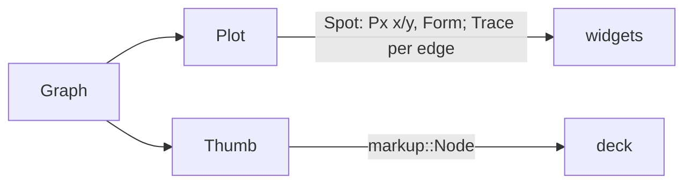

# layout

Pure geometry, no DOM: the graph widget's rows and columns, edge routes (down, same-row arcs,
loop-backs), and the deck's thumbnails. Geometry is `Px`; edge routes are `markup::Trace`; the thumbnail is a `markup::Node`. Numbers
format exactly as JavaScript prints them.

`fixtures/dom` is frozen regression data (first read from the JS page, which is gone): the layout
tests check every coordinate against it, and it changes only deliberately, from the Rust side.
