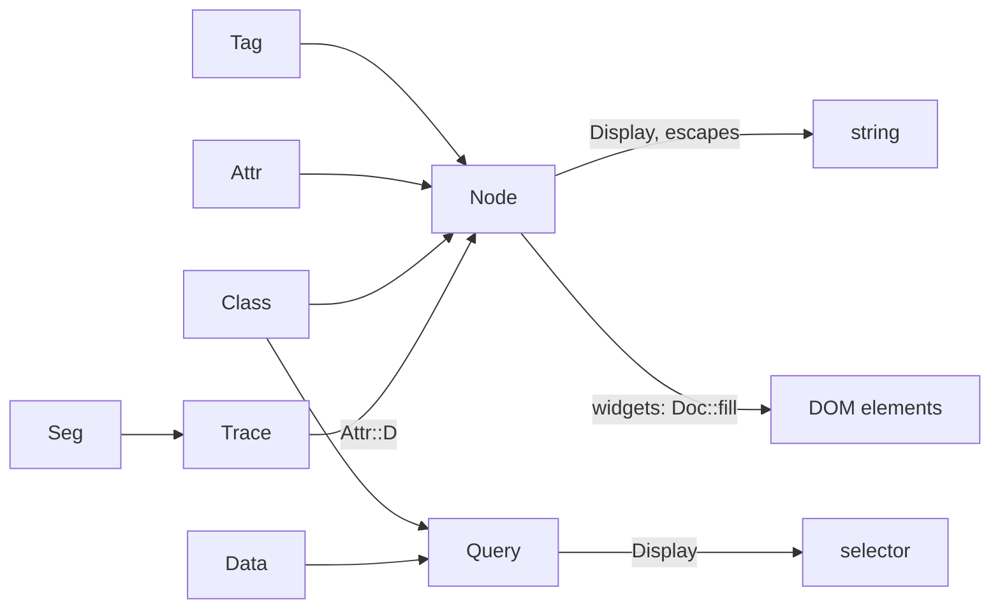

# markup

A typed tree of the HTML and SVG the widgets draw. `Node` is an element (tag, attributes in
writing order, children), a run of text, or a list; it is built by composition and never by string
accumulation. Every attribute value is typed (`Attr::Path(Path)`, `Attr::Uid(Uid)`, `Attr::Cx(Num)`,
`Attr::D(Trace)`, …); every class is a variant of the closed `Class` enum, so no widget can write a
class the stylesheet does not know; data attribute names live in `Data`; selectors are built as
`Query` values from the same pieces.

- `Node`'s `Display` is the only place markup becomes a string, and the only place anything is
  escaped. Its output must equal the JS renderers' byte for byte (attribute order, `/>` on empty
  SVG elements, number formatting), which `widgets/tests/blocks.rs` and the layout tests check.
- `Num` carries a number with the JS formatting it was written with (`String(x)` or `toFixed(1)`);
  `Trace` is SVG path data, spaced (`M0 0 C…`) or tight (`M0 0L1 1Z`) as the JS wrote it.
- No DOM and no Leptos: `widgets` builds real elements from a `Node` (`Doc::fill`).
