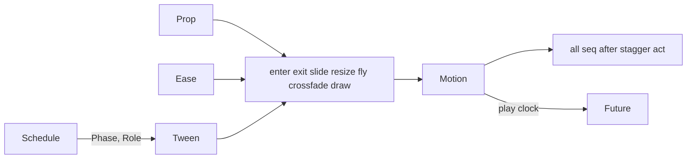

# motion



The only crate that calls `Element::animate`. A `Motion` plays at a `Clock` speed and always
resolves: each primitive races a timer. `Prop` names the CSS properties it touches; `Ghost` pins
a copy of an element over the page for FLIP; `Cue` marks firing phases on the performance timeline.

## The step

Every firing is one step on one timeline, the same for every rule and every term size:

```
       Hold 560          Move 620                      Settle 240
|------------------|---------------------------|----------|        (speed 1: Schedule::STEP)
 match painted,     Fade   ===========                                husk fades out   (0–.55)
 rule card shows    Swap   ========                                   copies crossfade (0–.45)
 the bindings       Fly    ===========================                pieces travel    (0–1)
                    Arrive ===========================                result fades in  (0–1)
                    Glide  ===========================                context slides   (0–1)
```

- `Phase` (Hold, Move, Settle) and `Role` (Fade, Swap, Fly, Arrive, Glide) are types; their
  lengths and windows live there and nowhere else. `Schedule::part(role)` is the only way the
  workbench gets a tween's timing for a move.
- Every part starts at the top of the move and ends by its end: no stagger, nothing that grows
  with the number of pieces or copies. Phase boundaries are deadlines counted from the step's start
  (`Schedule::until`), so work inside a phase (drawing the new term) never lengthens the step.
- An α step that must precede a β or ζ is a step of its own on the same timeline.
- `Schedule::STEP` (speed 1, 1420 ms) for Step and clicks; `Schedule::RUN` (speed 2, 710 ms) for
  Normalize and To WHNF, every step at the same cadence. `tests/schedule.rs` pins all of this.
- Reduced motion skips the timeline: steps apply at once.
