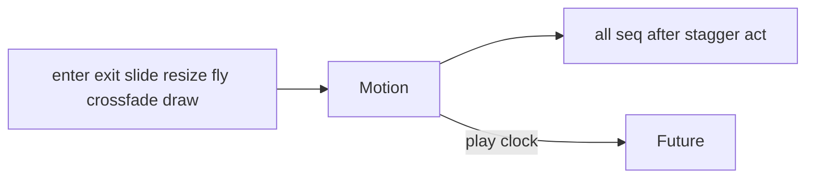

# motion

The only crate that calls `Element::animate`. A `Motion` plays at a `Clock` speed and always
resolves: each primitive races a timer. `BEAT` and `EASE` are the timing constants; `Ghost` pins a
copy of an element over the page for FLIP.
