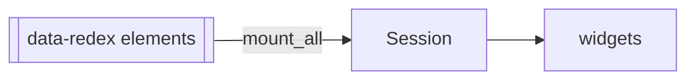

# redex

The facade: `mount_all` mounts every `[data-redex]` element on the page with one shared session,
and is exported to JavaScript for host pages.

Builds: `trunk build --release` makes the standalone page (`bin/page`); `scripts/site.sh` makes
`dist/site/{redex.js, redex_bg.wasm, redex.css}` for a host page (`import init, { mountAll }`,
`await init()`, `mountAll()`); `scripts/bundle-wasm.mjs` inlines the page, styles, glue and wasm
into one file. `mount_all` is the crate's one free function: wasm-bindgen exports a module-level JS
function only from a bare `fn`, so it carries a `lint:allow(free-function)`.
