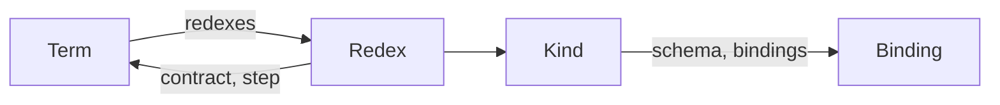

# rules

The seven rules (α β η δ ζ ι π; η has a structure variant). Each `Kind` has a schema over pattern
variables and `bindings`, which say where each variable sits inside a redex. Every node a contraction
builds from an old one records `from`; that is all the workbench needs to animate it.
