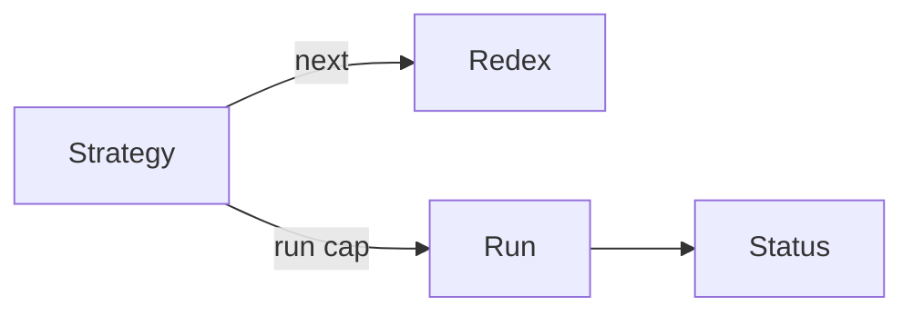

# strategy

Normal order (leftmost-outermost), applicative order (leftmost-innermost) and weak head order.
None of them performs η. `Run` stops at the cap, at a normal form, or when the term passes 1500 nodes.
