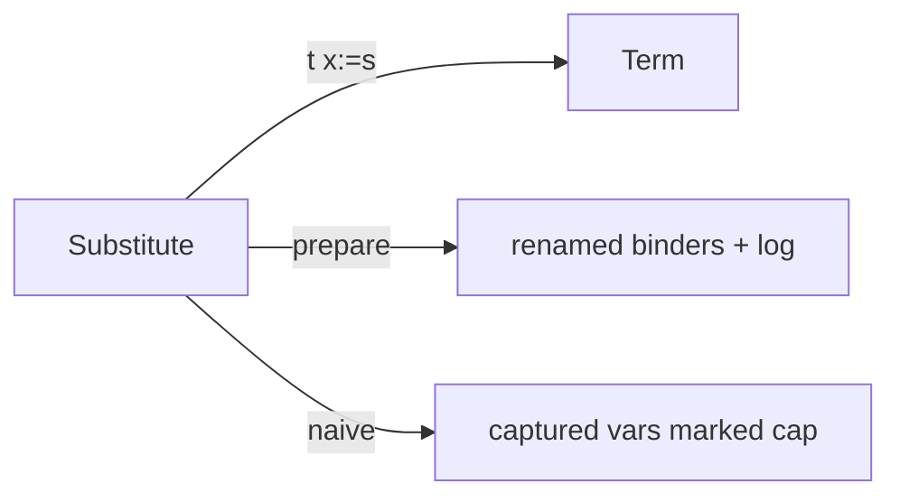

# subst

`Substitute` is implemented for `Term`. `subst` renames a binder only when it would capture a free
variable of the argument; `prepare` does just that renaming and logs it (the workbench shows it as an
α step); `naive` substitutes blindly and marks what it captured, for the capture demo.
