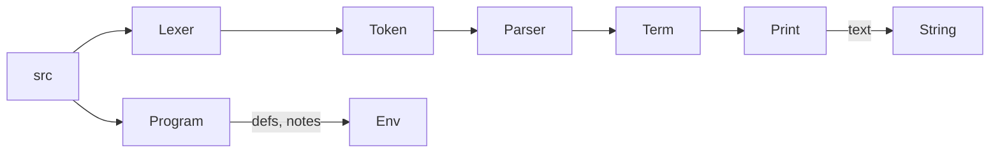

# syntax

Lean-flavoured surface syntax: `λx. t` / `fun x => t`, `let x := v; t`, pairs, `.1` `.2`, numerals
up to 40, `def name := t` lines and `--` notes. Error messages are user copy and match the JS
engine word for word (see `fixtures/engine/errors.json`).
