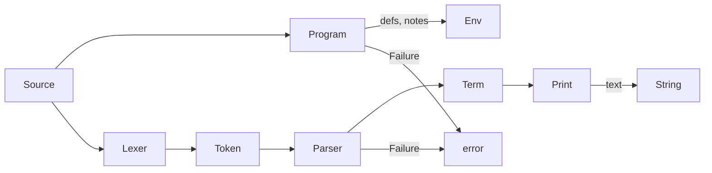

# syntax

Lean-flavoured surface syntax: `λx. t` / `fun x => t`, `let x := v; t`, pairs, `.1` `.2`, numerals
up to 40, `def name := t` lines and `--` notes. A program's text is a `Source`; a failure is a `Failure`, and its message is user copy that
is pinned word for word by `fixtures/engine/errors.json`.
