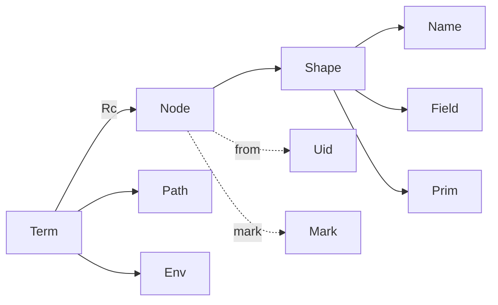

# term

A `Term` is an `Rc<Node>`. A node's shape never changes; its decorations do: `from` (the uid of the
node it was built from), `mark` (a flash class for the renderer) and `cap` (a captured variable in
the naive substitution) sit in `Cell`s, because the workbench strips them after the first render
and history entries share subtrees, exactly as the JS engine mutates them.

- Uids come from one per-thread counter. Allocation order is part of the spec: the golden fixtures
  record ids relative to a probe node, so build children before parents, left to right, as the JS does.
- Names are `Name`; the built-ins are `Prim`; a projection's side is `Field`; a term's α-key is
  `Key`, its node count `Size`, a numeral's value `Nat`.
- `Consts` is the per-thread set of constant names (`zero`, `succ`, `Nat.rec`, plus every name a
  session has defined). `fresh` never returns one of them.
