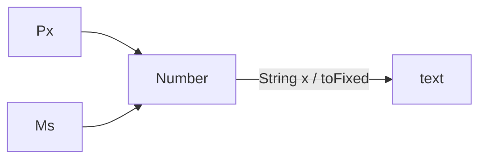

# units

The bottom crate. `Px` is a length or coordinate in CSS pixels, `Ms` a duration; each has only the
arithmetic its callers need, so pixels never mix with milliseconds or plain numbers. `Number`
prints a number as JavaScript does (`String(x)`, `x.toFixed(n)`), because SVG coordinates and error
copy must match the JS widgets character for character.
