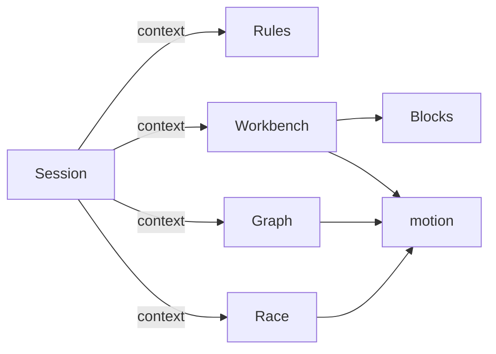

# widgets

Leptos components. Every widget reads and writes the shared `Session` (program, history, cursor,
capture, busy) from context and never touches another widget's DOM. `redex.css` here is the one
stylesheet; every selector starts with `.redex`. Exempt from `one-type-per-file` and `pub-field`
(see House Lint), not from `free-function`.
