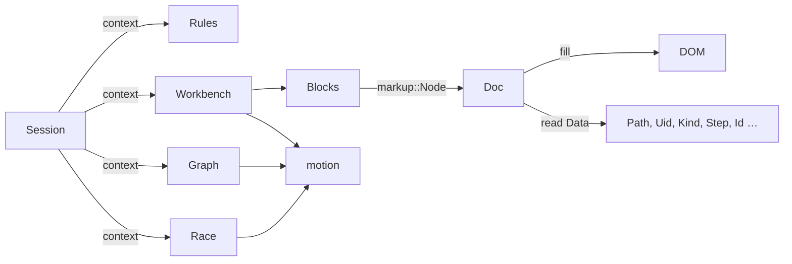

# widgets

Leptos components: `Deck` (rules), `Workbench`, `Paths` (graph), `Lanes` (race). Every widget reads and writes the shared `Session` (program, history, cursor,
capture, busy) from context and never touches another widget's DOM. Term-shaped regions are `markup::Node`s that `Doc::fill` builds into real elements; data
attributes are read back with `Doc::read` into their types and queried with `markup::Query`.
`redex.css` here is the one stylesheet; every selector starts with `.redex`. Exempt from `one-type-per-file` and `pub-field`
(see House Lint), not from `free-function`.

The workbench has a fixed shape so it never changes height: the program band (notes, and each
`def` as one line of source), the rule card, the stage (`20rem`; a larger term scrolls inside it,
never scales), a status line of fixed height, the controls, and one lower pane whose tabs (Trace,
Why, Source) share a fixed-height panel. Stop is drawn over Step's box so the label never rewraps.
The root carries `aria-busy` while a firing runs; the browser checks wait on it.

The blocks markup in `fixtures/engine` is frozen regression data; `tests/blocks.rs` checks the
renderer against it byte for byte, and it changes only deliberately, from the Rust side.
